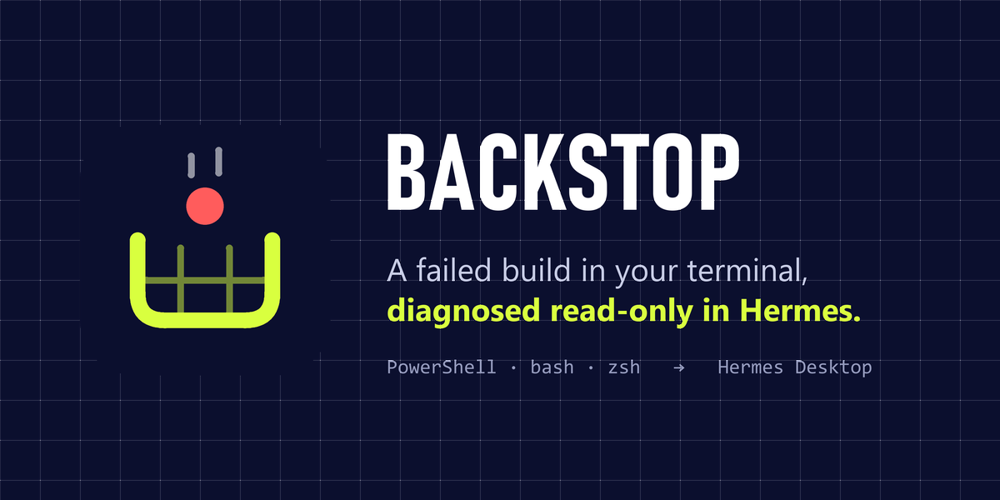
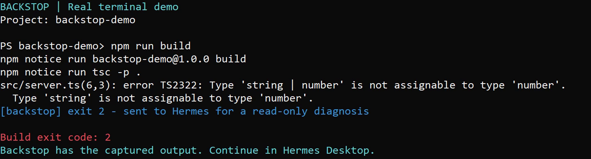
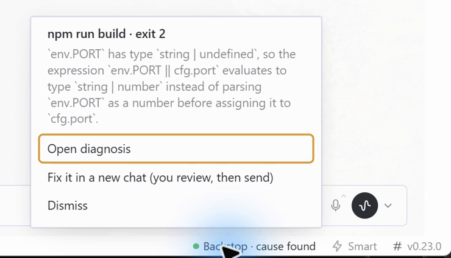
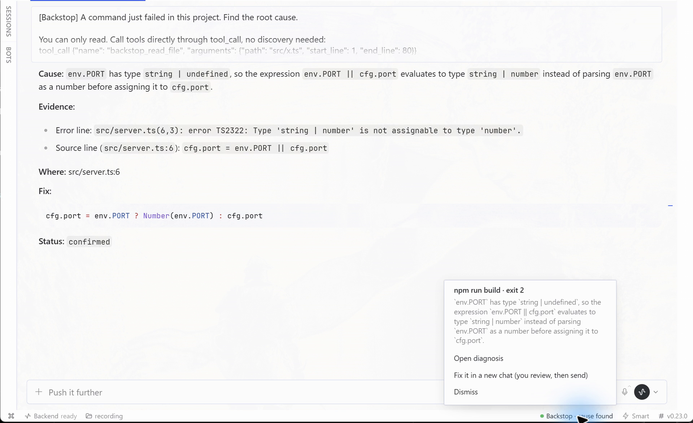
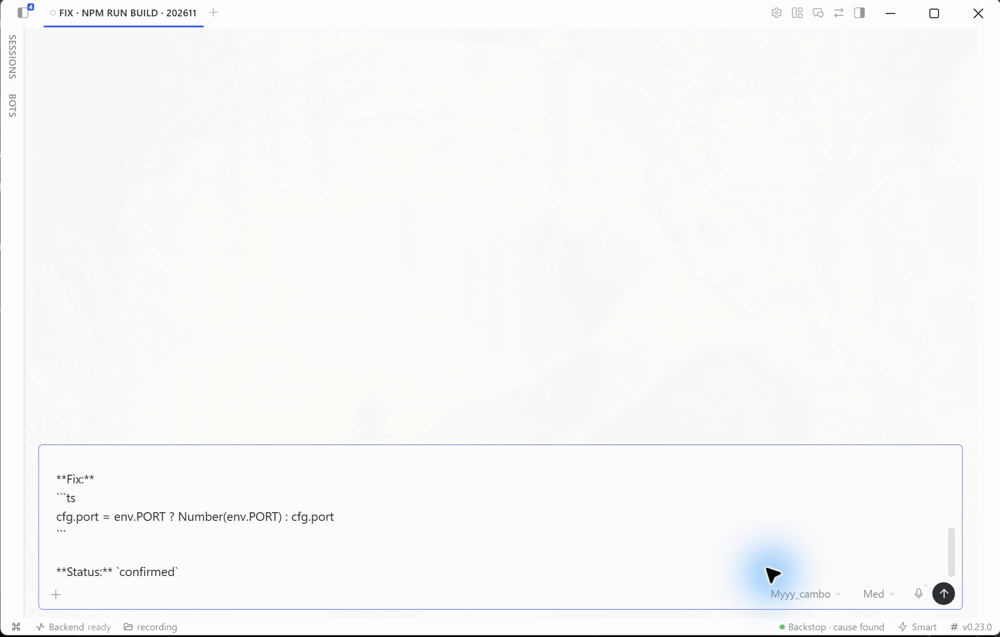
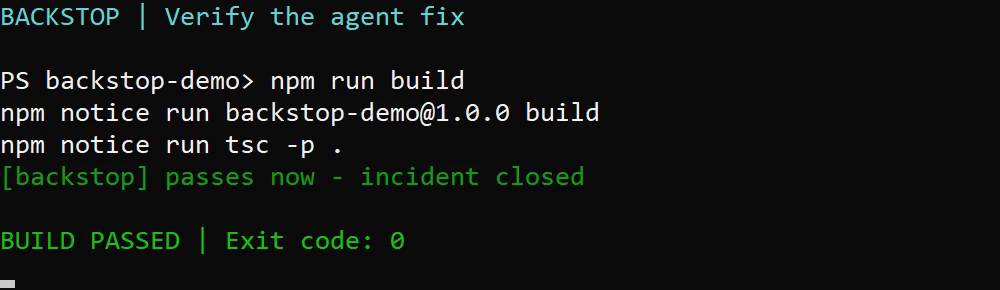
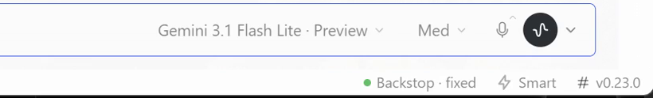

# Backstop



When a build or test command fails in your terminal, Backstop asks Hermes why. You don't need to copy or paste anything.

```
PS> npm run build
src/server.ts(6,3): error TS2322: Type 'string | number' is not assignable to type 'number'.
[backstop] exit 2 - sent to Hermes for a read-only diagnosis
```

When the diagnosis is ready, Hermes Desktop shows a notification. How long that takes depends on your model; in our tests it took 30 to 160 seconds.

> **Backstop: npm run build (exit 2)**: `env.PORT` is `string | undefined`, so `cfg.port` becomes `string | number` · `src/server.ts:6`

Click it to open the diagnosis session. Every diagnosis has these parts:

- **Cause.**
- **Evidence:** the exact error line and the exact source line, both quoted.
- **Where:** the `path:line` to look at.
- **Fix.**
- **Status:** `confirmed` only when the agent read the source line behind the error. Otherwise the result is labelled `hypothesis`, and the toast says *likely cause* instead of *cause found*.

Next you can choose **Fix it in a new chat** from the status-bar chip. This opens a normal Hermes chat in the project, with your usual tools and approvals, and puts the fix in its composer. Nothing is sent until you press Enter.

When the same command later passes in the same directory, Backstop closes the incident:

```
PS> npm run build
[backstop] passes now - incident closed
```

Desktop then shows *“npm run build passes now · 3.2 min from failure to green”*.

## Why it is a plugin and not a prompt

- **It captures the real output.** A shell hook keeps what the command printed, with its exit code, directory and duration. The command is never re-run.
- **The diagnosis session is read-only.** Backstop creates the session with `toolsets: ["backstop"]`. That session's only tools are `backstop_read_file`, `backstop_search` and `backstop_list`, and they stay inside the project directory. The tools also check the session's policy and refuse to run in any other chat.

  We tested this: a session was told to create a file, run `whoami` and edit a source line. `tool_search` found only the three read tools, no file appeared, and the source file's hash did not change.
- **It warns you when a result is stale.** Backstop takes a fingerprint of the project when the command fails and again when the answer arrives. If you edited files in between, the result is marked **stale** and the changed files are listed.
- **It requests a turn cap and limits waiting time.** Each diagnosis session requests `max_turns` (default 8). Gateways that explicitly reject this option are retried without it and show a warning: the turn cap is unavailable there. After 5 minutes without a result, Backstop requests interruption of its diagnosis session. It does not claim a strict spending cap.
- **It skips what isn't worth diagnosing:**
  - Exit 0.
  - Ctrl-C (130 / `0xC000013A`).
  - Empty output.
  - Interactive commands (REPLs, `npm init`, `--watch`, dev servers).
  - The same failure seen again within 10 minutes.

## How it works

```
shell hook ──► <HERMES_HOME>/plugin-data/backstop/spool/<id>.json
                     │  (gateway backend picks it up within 1 s, dedupes, fingerprints)
                     ▼
        plugin.backstop.failure.new ──► Desktop half
                     │  session.create {cwd, toolsets:["backstop"], model?}
                     │  prompt.submit  (output tail + source around the failing line)
                     ▼
        message.complete ──► /result (ready | stale) ──► toast + OS notification ──► open session
```

## Requirements and known limits

- **Hermes 0.22.5 or newer, with the native Hermes Desktop app open.** The Desktop half starts each diagnosis. With no Desktop window open, a failure waits for 30 minutes and then expires. Backstop does not diagnose anything from the CLI alone.
- **Tested end to end on Windows only:** Hermes 0.22.5 (agent), Desktop 0.23.0 and PowerShell 7. The bash and zsh hooks are tested by CI (Linux, macOS and Git Bash on Windows) up to the spool record that the gateway reads. A full run through the gateway and Desktop has not been tested on them.
- **The turn cap is only a request.** Some gateways reject `max_turns`. Backstop then retries without it and shows a warning, so on those gateways a diagnosis has no turn limit. The 5-minute timeout still applies.
- **A diagnosis takes time.** In our tests it took 30 to 160 seconds, depending on the model.
- **One import is internal to Hermes** (see Disclosure). The tools use Hermes' session policy to refuse to act outside a Backstop session. Hermes has no public API for this check yet. If a future release changes the internal one, the tools refuse to run at all. They never fall back to running unchecked.

## Install

1. Put this folder in `<HERMES_HOME>/plugins/backstop` and enable it under **Capabilities → Plugins**. Enable the Desktop half there too.
2. **Optional:** choose the model for diagnoses in the plugin settings (`diagnosis_model`). If you leave it empty, Backstop uses your default model.
3. Load the shell hook. PowerShell 5.1 and 7 are supported:

   For an opt-in Windows terminal without changing your saved execution policy, open
   `shell/backstop-terminal.cmd`. Its PowerShell process loads the hook for that window only.
   You can instead add the hook to a PowerShell profile when your policy permits profiles:

   ```powershell
   & "$env:LOCALAPPDATA\hermes\plugins\backstop\shell\install.ps1"            # -Uninstall to remove
   ```

   The installer adds one line to your profile. It never changes your execution policy. If your policy blocks profile scripts, the installer tells you so and shows the command that allows them.

   **bash and zsh** (Linux, macOS, Git Bash on Windows):

   ```sh
   sh ~/.hermes/plugins/backstop/shell/install.sh          # your $SHELL; or: install.sh bash zsh / --uninstall
   ```

   This adds one line to `~/.bashrc` or `~/.zshrc`. The hook loads only in interactive shells. A command is wrapped only when both stdin and stdout are a terminal, so pipes, redirects and `$(...)` run untouched. Turn it off with `BACKSTOP_DISABLE=1`, check it with `backstop_status`, and remove the wrappers from one shell with `backstop_disable`.

The hook wraps an opt-in list of commands: `npm`, `npx`, `pnpm`, `yarn`, `bun`, `deno`, `tsc`, `node`, `python`, `py`, `pytest`, `cargo`, `go`, `dotnet`, `make`, `gradle`, `mvn`, `eslint`, `jest`, `vitest`, `ruff` and `mypy` (bash/zsh also wrap `python3`).

- Override the list with `$env:BACKSTOP_COMMANDS = 'npm,pytest'`.
- Turn it off in one shell with `$env:BACKSTOP_DISABLE = '1'`.
- Check what is active with `Get-BackstopStatus`.
- In a PowerShell function call, quote a literal argument separator: `npm run build '--' --pretty false`.

**Trade-off:** a wrapped command writes to a pipe instead of a console, so its output has no colours. When a wrapped command is piped (`npm ls | sls x`), it runs untouched.

## Disclosure

- **Model calls (inference cost):** every recorded failure automatically starts **one** diagnosis session, and nobody has to approve it first. That session sends this data to **the model you configured, which may be a cloud provider**:
  - The tail of the failed command's output, after secrets are redacted with Hermes' `redact_sensitive_text` (forced on).
  - The command line and the working directory.
  - Excerpts of project files.

  Backstop makes no network calls of its own; everything goes through Hermes' session API with your provider.
- **Reads outside its own data:**
  - The gateway reads the project files the error output points to, so it can quote them.
  - The gateway records the size and mtime of the project's files, before and after the diagnosis, to detect a stale result. It skips `.git`, `node_modules`, virtualenvs and build output.
  - The diagnosis tools read files only inside that project directory.
- **What is never read:** every read (tools, quoted excerpts, search, listing) goes through one gate:
  - Hermes' own read denylist (`agent.file_safety.get_read_block_error`): credential stores, project `.env` files, internal caches.
  - Any dot-prefixed path below the project (`.env*`, `.ssh`, `.git`, `.aws`, `.npmrc` …). Hidden entries are also left out of listings and searches.
  - A failure is not diagnosed at all when it ran in your home directory (or a parent of it), a filesystem root, anywhere under `HERMES_HOME`, or inside a dot-directory. Command output can be steered by an attacker, so the diagnosis never gets a root where secrets live.
- **Files it writes:**
  - The shell hook writes one JSON file per failure to `<HERMES_HOME>/plugin-data/backstop/spool/`. The gateway deletes it after reading. bash/zsh write it owner-only (mode 0600) and capture output in a private `mktemp` file that is removed after the run; PowerShell keeps the output in memory.
  - The shell hook writes one small marker per open incident to `plugin-data/backstop/open/`.
  - Backstop appends status lines (no output text) to `plugin-data/backstop/history.jsonl`.
  - Backstop never modifies project files.
- **Shell:**
  - The hook defines PowerShell, bash or zsh functions that shadow the listed commands. Each command still runs exactly once, and Backstop never re-runs one.
  - `shell/install.ps1` adds one line to your PowerShell profile and `shell/install.sh` adds one line to `~/.bashrc` / `~/.zshrc`. Both have an uninstall option. Neither changes your execution policy.
  - `shell/backstop-terminal.cmd` opens one PowerShell window with `-ExecutionPolicy Bypass` for that process only, so you can try the hook without changing any setting.
- **Background work:** one thread inside the Hermes gateway polls the spool directory once a second. Nothing waits for a person. A failure that no Desktop window picks up expires after 30 minutes, and a diagnosis with no answer is interrupted after 5 minutes.
- **Edits only with your approval:** the diagnosis session has read-only tools. **Fix it** only drafts a message into a normal chat, which keeps your usual tools and approvals. Nothing is sent until you press Enter.
- **Credentials and telemetry:** none. Backstop stores no credentials and reports nothing anywhere.
- **Version coupling:** `gateway.session_policy.active_policy` is the read-only guard; Hermes has no public "active session toolsets" API yet. If it ever disappears, the tools refuse to run. `agent.file_safety` and `agent.redact` are used as the Hermes reviewers recommended; each has a built-in fallback.

## Screenshots

These were captured from a real run on Windows with Hermes Desktop 0.23.0.








## Tests

```
uvx --with pytest --with fastapi pytest -q
node --test tests/desktop.test.cjs
```

## License

MIT
